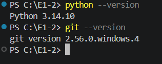
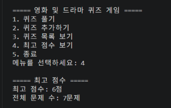
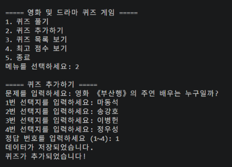
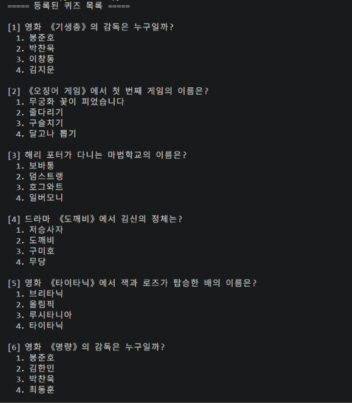
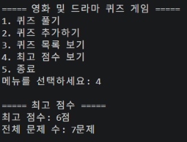

# 영화 및 드라마 퀴즈 게임

## 1. 프로젝트 소개

영화와 드라마에 관한 퀴즈를 풀고, 새로운 문제를 추가하며, 최고 점수를 기록할 수 있는 Python 콘솔 게임입니다.

평소 접하기 쉬운 영화와 드라마를 주제로 선정하여 재미있게 Python의 기초 문법과 객체지향 프로그래밍을 연습할 수 있도록 제작했습니다.

## 2. 개발 환경


- OS: Windows 10/11
- Language: Python 3.10 이상
- Editor: Visual Studio Code
- Terminal: VS Code PowerShell
- Version Control: Git / GitHub

## 3. 주요 기능 및 실행 화면

### 3-1. 퀴즈 풀기
등록된 영화 및 드라마 퀴즈를 풀고 최종 점수를 확인합니다.



### 3-2. 퀴즈 추가하기
새로운 문제와 4개의 선택지, 정답을 입력하여 퀴즈를 추가합니다.



### 3-3. 퀴즈 목록 보기
등록된 전체 퀴즈와 선택지를 확인합니다.



### 3-4. 최고 점수 보기
게임에서 기록한 최고 점수와 전체 문제 수를 확인합니다.



## 4. 실행 방법

프로젝트 폴더에서 VS Code 터미널을 열고 다음 명령어를 실행합니다.

```bash
python main.py
```

## 5. 메뉴 구성

```text
===== 영화 및 드라마 퀴즈 게임 =====
1. 퀴즈 풀기
2. 퀴즈 추가하기
3. 퀴즈 목록 보기
4. 최고 점수 보기
5. 종료
```

## 6. 프로젝트 구조

```text
E1-2/
├── docs/
│   └── screenshots/
├── .gitignore
├── main.py
├── README.md
└── state.json
```

## 7. 데이터 저장 방식

퀴즈 데이터와 최고 점수는 프로젝트 루트의 `state.json` 파일에 JSON 형식으로 저장됩니다.

- `quizzes`: 문제, 선택지, 정답 정보
- `best_score`: 최고 점수

데이터 예시:

```json
{
    "quizzes": [
        {
            "question": "영화 《기생충》의 감독은 누구일까?",
            "choices": ["봉준호", "박찬욱", "이창동", "김지운"],
            "answer": 1
        }
    ],
    "best_score": 5
}
```

## 8. 사용 기술

- Python 클래스와 객체
- 리스트와 반복문
- 조건문과 예외 처리
- JSON 파일 입출력
- Git 및 GitHub를 이용한 버전 관리

## 9. 입력 검증 및 예외 처리

사용자가 잘못된 값을 입력하더라도 프로그램이 정상적으로 동작하도록 입력 검증 기능을 구현했습니다.

- 문제와 선택지를 빈칸으로 입력하면 다시 입력하도록 처리
- 정답 번호는 1~4 사이의 숫자만 허용
- 숫자가 아닌 입력이나 범위를 벗어난 입력에 대한 오류 안내
- 메뉴에서 잘못된 번호를 입력하면 다시 선택하도록 처리
- Ctrl+C 또는 입력 종료 상황에서도 데이터 저장 후 종료
- JSON 파일이 없거나 손상된 경우 예외 처리

